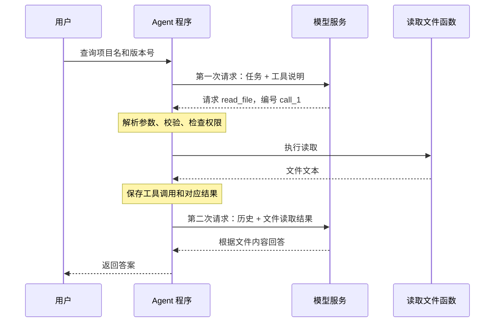

# 第一讲：从一次模型调用到最小 Agent

这一讲要建立一个具体认识：**在我们研究的这类工具型 LLM Agent 中，模型根据上下文提出下一步，程序执行被允许的动作，把结果放回上下文，再调用模型。**

Agent 在其他领域有更广的定义。本文聚焦 DeepSeek Harness 这类以大语言模型为决策组件的工具型智能体。

读完后，你应该能够解释：模型实际收到了什么、工具是谁执行的、为什么通常需要多次模型调用，以及 Agent 的“记忆”由谁保存。

[返回学习路线](README.md)

## 1. 先看一个任务

用户说：

> 看一下这个项目的 package.json，告诉我项目名和版本号。

假设文件内容是：

```json
{
  "name": "learning-demo",
  "version": "0.1.0"
}
```

这是为教学准备的示例文件，内容与 DeepSeek Harness 自身的 package.json 不同。

这个任务包含三个动作：知道要查看哪个文件、实际读取文件、根据读取结果回答。只要看清这三个动作分别由谁完成，就抓住了 Agent 的起点。

## 2. 最底层的起点：一次模型调用

从应用开发者的视角，一次模型调用可以暂时写成：

```python
response = call_model(request)
```

这段代码表达的是：程序把一份请求发送给模型服务，等待响应。网络、身份验证和流式传输的细节留到第二讲。

对常见的生成式语言模型而言，输入被表示成 token 序列，模型根据已有内容逐步生成后续 token。Token 是模型处理的基本片段，可能是一个词、一个词的一部分、一个汉字或其他片段，具体取决于分词器，不能简单等同于“一个字”。

模型经过训练后，可以生成符合工具调用协议的结构化内容。对我们写程序而言，重点是模型接口最终提供哪些字段，以及程序怎样解释这些字段。

这次请求通常包含：

- 使用哪个模型，以及输出长度等配置。
- 本次要提供给模型的消息和上下文。
- 模型可请求使用的工具及其参数说明。

响应可能包含普通文字、工具调用，也可能包含其他内容块和结束原因。一次响应可以同时有文字和工具调用，不能只按“有文字就完成”来判断。

### 2.1 模型为什么不知道你的本地文件内容？

对这个例子来说，模型服务没有自动获得你电脑上项目目录的访问权。请求里只有“请读 package.json”这几个字，模型就只有文件名，没有文件内容。

要让它依据这个文件回答，系统需要把文件内容送入本次请求，或者提供读取文件的工具，并在执行后把结果送入后续请求。

这两种方式都需要应用程序参与。文件放在磁盘上，不等于文件内容已经进入模型的上下文。

### 2.2 模型是否会自动记住上一轮？

在常见的显式传入消息列表的调用方式下，下一次请求需要由应用提供需要保留的历史。也有 API 提供服务端会话或前序响应引用，但依然存在负责保存和恢复状态的系统。

因此，开发 Agent 时要明确：**下一次调用能使用哪些信息，由本次实际提供或服务端恢复的上下文决定。**不能只因为界面还显示着上一条消息，就认定模型这次也能看到它。

模型参数中的训练知识、请求中的历史记录、服务端缓存，是三个不同概念。缓存可以优化计算，但不能取代应用对会话状态和上下文的管理。

## 3. 消息：把任务和过程交给模型的数据

先用一种简化的消息格式：

```json
[
  {
    "role": "system",
    "content": "根据实际读取结果回答项目问题。"
  },
  {
    "role": "user",
    "content": "读取 package.json，告诉我项目名和版本号。"
  }
]
```

`role` 表示消息的角色，`content` 是其内容。常见角色如下：

| 角色 | 在这个例子中的用途 |
|---|---|
| system / developer | 提供应用规则和行为要求；具体支持及编码方式随 API 而异 |
| user | 提供用户任务 |
| assistant | 保存模型返回的文字或工具调用 |
| tool | 保存工具执行结果，并关联对应调用 |

这些角色属于模型协议。应用可以使用自己的内部表示，再由适配器翻译为供应商要求的格式。

一个容易漏掉的点是：**工具调用本身也属于对话过程。**如果模型先提出读取文件，程序就应当保留这次 assistant 工具调用，再添加对应的 tool 结果。只把一个孤立结果塞进去，会丢失“这个结果回应了哪一个请求”的关系；具体协议还可能直接拒绝这样的消息序列。

## 4. 工具：说明书、调用请求和执行函数

这三样东西都与工具有关，但职责不同。

### 4.1 工具说明：模型可以请求什么

应用准备一个读取文件的工具定义。下面是教学用的通用表示，外层字段并非某个供应商的完整 API 格式：

```json
{
  "name": "read_file",
  "description": "读取教学工作区中的 package.json，以 UTF-8 文本返回。",
  "parameters": {
    "type": "object",
    "properties": {
      "path": {
        "type": "string",
        "enum": ["package.json"]
      }
    },
    "required": ["path"],
    "additionalProperties": false
  }
}
```

这里的 schema 就是一份参数结构说明：参数是一个对象，必须包含字符串 path，这个实验只允许它等于 package.json。

工具说明要进入模型请求，模型才有依据选择正确的名称和参数。它通常不需要看到读取文件函数的实现源码。

### 4.2 工具调用：模型提出要做什么

模型可能返回如下调用。这里仍使用我们自己的教学格式：

```json
{
  "id": "call_1",
  "name": "read_file",
  "arguments": "{\"path\":\"package.json\"}"
}
```

它表达的是：“请调用 read_file，参数是这个路径。”

`arguments` 在这个表示中是一个包含 JSON 的字符串。外部 API 或框架也可能提供已解析的对象。我们选择保留原始字符串，方便观察程序还需要做 JSON 解析这一步；DeepSeek Harness 的内部 ToolCallBlock 也保留原始参数字符串。

`id` 用于把调用和结果配对。一次响应可以要求读两个文件，甚至同一个工具被调用多次，只靠工具名不能区分结果属于哪一次调用。

**到这一步，文件还没有被读取。模型产生的是待执行的数据。**

### 4.3 工具实现：普通程序实际执行动作

应用中需要真正存在一个函数，例如：

```python
def read_file(path):
    # 教学工具只接受这个文件名。
    if path != "package.json":
        raise ValueError("当前工具只允许读取 package.json")
    return fixture_path.read_text(encoding="utf-8")
```

程序还需要一个名称到函数的映射：

```python
tools = {"read_file": read_file}
```

这样收到名称 read_file 时，才知道执行哪个函数。这个映射就是最简单的工具注册表。

执行前要由程序解析参数、检查工具存在、校验参数，并执行当前权限规则。发送给模型的 schema 有助于正确生成参数，却不能代替执行端的检查。Python 或 TypeScript 中的类型声明，也不会自动验证模型传来的外部数据。

这里的核心分工是：模型选择它认为有用的动作，程序决定这个动作能否执行，并负责真正执行。

### 4.4 工具结果：把观察到的事实交回去

程序读取文件后，生成一条与调用对应的结果消息：

```json
{
  "role": "tool",
  "tool_call_id": "call_1",
  "content": "{\"name\":\"learning-demo\",\"version\":\"0.1.0\"}"
}
```

工具结果也可能是失败信息，例如文件不存在。程序应当如实表示结果，模型才能根据失败原因调整下一步。文件内容只是一份外部数据；把它加入上下文，也不意味着其中任何文字都获得了应用规则的权限。

## 5. 为什么还要调用第二次模型？

第一次调用时，模型只知道任务和工具目录，所以提出读文件。程序执行后拿到了文件内容，但第一次模型响应已经结束；结果不会自动进入那次已经结束的调用。

程序需要再发起一次请求。到第二次请求时，历史成为：

```text
system：根据实际读取结果回答。
user：告诉我项目名和版本号。
assistant：请求 read_file("package.json")，调用编号 call_1。
tool：call_1 的结果是 {"name":"learning-demo","version":"0.1.0"}。
```

模型现在有了文件内容，可以返回：

> 项目名是 learning-demo，版本号是 0.1.0。

这个特定任务当然也可以由固定代码直接读取和解析 JSON。我们使用它，是为了让每一步的数据变化清楚可见；当输入任务变化、需要根据结果选择下一步时，模型参与决策才更有价值。



图中调用读取函数的是 Agent 程序；模型服务负责返回请求动作和最终文字。

## 6. 把这个过程写成循环

如果任务要读三个文件、改代码、运行测试，那么一次工具执行后，模型可能还需要提出下一次动作。于是我们把上面的过程写成循环。

下面是刻意简化的伪代码，不是 DeepSeek Harness 的 SDK 接口：

```python
history = [application_rules, user_message]

for step in range(max_steps):
    response = call_model(history, tool_definitions)
    history.append(response)

    if response.is_error_or_truncated:
        return stopped_with_reason(response)

    if not response.tool_calls:
        return completed_with_answer(response.text)

    for call in response.tool_calls:
        result = validate_and_execute(call)
        history.append(tool_result_message(call.id, result))

return stopped_because_step_limit_was_reached()
```

循环中有四件事需要分清：

| 部分 | 负责什么 | 省掉会发生什么 |
|---|---|---|
| 模型调用 | 根据当前信息提出回答或动作 | 系统只能执行预先写死的决策 |
| 工具执行器 | 校验并执行动作，返回结果 | 模型只能描述想做什么 |
| 历史 / 状态 | 保存之前发生的事情，提供后续上下文 | 后续调用可能不知道结果，反复做同一件事 |
| 循环与停止策略 | 安排下一次调用，决定何时结束 | 工具执行后无法继续，或循环没有可靠边界 |

这就是这个最小 Agent 的组成。后面的大部分工程设计，都可以追溯到这几个职责遇到的新问题。

## 7. 两类状态，先别混在一起

我们说“Agent 有状态”，至少包含两类。

**任务和对话状态**包括用户要求、模型已经请求过哪些动作、工具返回了什么。它的一部分会成为模型下一次请求的上下文。

**程序运行状态**包括当前在等待模型还是执行工具、已经用了几步、是否收到取消信号、哪个请求失败了。这些由程序维护，不一定全部发送给模型。

用两个问题就能区分它们：

- “package.json 的版本号是多少？”属于任务内容。
- “当前这次网络请求是否已被用户取消？”属于执行管理。

最小示例用一个内存列表保存消息，再用循环计数保存执行进度。进程退出后，这些内存状态就丢了。需要重启恢复时，才进一步引入持久化会话日志。

持久化日志与发给模型的上下文也不完全相同：日志可以保存完整事件，模型请求可能只使用其中一部分或其摘要。后续第四、第五讲会拆开这两个概念。

## 8. 谁说了算：完成、失败和验证

模型返回一句“已经完成”，首先表示它生成了这句话。实际任务有没有完成，需要看相关证据。

在这个例子里，证据是文件读取结果。对于修复代码，证据可能是变更内容和测试结果。Agent 程序可以根据应用要求继续运行检查，也可以把事实交给用户判断。

因此，要区分三个状态：

- 模型这一次生成结束了。
- Agent 这一轮执行结束了。
- 用户的目标已经被验证完成了。

三者没有天然等号。输出长度用完、网络错误、预算耗尽或用户取消，都可能使执行停止，但它们不能被当成任务成功。

在教学循环中，我们以“正常响应且没有工具调用”作为结束本轮的条件，再另外报告步数上限。完整系统会增加错误分类、取消、审批、预算和验证策略。

## 9. Agent 与固定工作流的关系

固定工作流也可以有循环、分支和多次模型调用。区别要看：哪些后续步骤由代码预先规定，哪些由模型根据当前观察动态选择。

例如，固定流程可以写成“读取指定文件 → 提取版本 → 输出”；工具型 Agent 可以接收不同问题，再选择读文件、搜索文本或运行检查。

实际产品常把两者结合：外层流程固定关键顺序，某些步骤交给 Agent 自主完成。自主程度是设计选择，并非越多越好。步骤明确、输入稳定的任务，普通代码往往更简单、更容易验证。

## 10. 运行一个看得见历史变化的小实验

实验位置：[examples/01-minimal-loop.py](examples/01-minimal-loop.py)。

在学习笔记仓库的根目录运行：

```powershell
python examples/01-minimal-loop.py
```

脚本会打印每次提交给“模型”的消息历史、模型响应、工具结果和停止原因。只依赖 Python 标准库，读取的是 examples/fixture/package.json。

**这里的模型是固定规则的模拟函数。**第一次请求读文件，之后根据工具结果输出答案。它让我们观察真实的循环和文件读取，但没有真实模型的推理、生成不确定性或网络调用。第二讲再替换这个函数。

正常情况下会观察到：

1. 第一次请求含 system 和 user 两条消息。
2. 模拟模型返回一次 read_file 调用。
3. 程序实际读取示例文件，并把 assistant 调用和 tool 结果都加入历史。
4. 第二次请求含四条历史消息。
5. 模拟模型根据实际结果回答，然后程序记录最终 assistant 消息，历史变成五条。

把最大模型调用次数改成 1，可以观察一种未完成状态：

```powershell
python examples/01-minimal-loop.py --max-steps 1
```

你会看到文件已经读到，但程序没有预算发起第二次模型请求，所以最终状态是 step_limit。这个例子直接展示：工具成功、循环停止和形成最终答案，是不同的事情。

本轮已在 Python 3.13.2 下实际运行这两条命令：正常运行经过两次模拟模型调用，最终历史为五条消息；步数上限为 1 时，最终历史为四条消息，状态为 step_limit。验证的是教学程序的数据流，尚未调用真实模型或启动 DeepSeek Harness。

### 可选的小改动

修改示例 package.json 的 version，再运行脚本，观察第二次请求和最终答案。答案随工具结果改变，说明后续决策使用了新观察到的信息。

这个实验的工具只允许读取一个固定文件。真实文件工具的路径解析、目录限制、大小限制和错误处理，会在第三讲具体实现。

## 11. 对应到 DeepSeek Harness 源码

先记住概念对应关系即可，不需要立即逐行理解全部实现。

| 本讲概念 | 仓库位置与符号 | 阅读目的 |
|---|---|---|
| 消息 | packages/llm/llm/src/message.ts | 查看 Message、AssistantMessage、ToolResultMessage |
| 工具调用数据 | packages/llm/llm/src/types.ts 中 ToolCallBlock | 确认 id、name、arguments 是数据字段 |
| 单次请求 | 同文件中的 GenerateOptions | 查看请求携带的配置、messages、tools |
| 单步执行 | packages/core/agent-loop/src/agent.ts 中 step() | 看到调用模型、保存响应、筛选工具调用和执行 |
| 多步循环 | 同文件中的 turn() | 看到一步结束后怎样继续或停止 |
| 工具调度 | packages/core/agent-loop/src/tool-calls.ts 中 executeToolCalls() | 看到模型参数如何进入程序执行流程 |
| 历史生成 | agent.ts 中 buildRequest() 调用 session.deriveMessages() | 看到模型消息由会话状态生成 |

固定版本的主要入口：

- [ToolCallBlock 等内部类型](https://github.com/deepseek-ai/deepseek-harness/blob/5badb15009ae1756c3afe0ae0cef1faafc290ccc/packages/llm/llm/src/types.ts)
- [ReactLoopAgent 实现](https://github.com/deepseek-ai/deepseek-harness/blob/5badb15009ae1756c3afe0ae0cef1faafc290ccc/packages/core/agent-loop/src/agent.ts)
- [工具调用调度实现](https://github.com/deepseek-ai/deepseek-harness/blob/5badb15009ae1756c3afe0ae0cef1faafc290ccc/packages/core/agent-loop/src/tool-calls.ts)
- [架构与 turn flow](https://github.com/deepseek-ai/deepseek-harness/blob/5badb15009ae1756c3afe0ae0cef1faafc290ccc/docs/architecture.md)

与教学循环相比，当前源码还处理流式响应、失败重试、取消、输入队列、工具并发及特殊结束结果。因此，不能把伪代码中的停止条件直接当成生产实现的全部规则。

仓库还有两个层次名称：一次逻辑模型步骤及其工具调用叫 step；一轮可以包含多个 step，叫 turn。step 内部的失败重试可能产生多次请求尝试，重试尝试不必各自成为新的 step。极端情况下 turn 也可能没有实际执行任何 step，例如输入在执行前被拒绝。

Cordis 的 ctx 是这些服务在程序中的访问入口。先把 ctx.llm 理解为“访问模型调用服务”，ctx.tools 理解为“访问工具服务”。插件怎样提供这些服务，后续再展开。

## 12. 本讲的三个思考问题

不必背术语，能说明因果即可。

1. 模型已经返回 read_file("package.json")，为什么我们还不能说它读到了文件？
2. 程序已经成功读到文件，如果第二次请求没有带上读取结果，会丢失什么能力？
3. 程序到达最大步数而停止，与用户任务已经完成，有什么区别？

<details>
<summary>自查要点：先回答，再展开</summary>

1. 工具调用是待执行数据。必须由程序分派到真实函数并成功执行，才有读取结果；模型要使用它，还需要后续请求把结果提供进去。
2. 模型无法依据本次读取的实际内容回答，可能再次请求读取、要求更多信息，或产生没有事实依据的回答。准确表现取决于模型，不能保证只发生其中一种。
3. 步数限制是执行资源边界，说明程序不能继续调用。任务完成需要符合用户要求，并有相关结果支撑；限制触发时可能还没有答案。

</details>

继续阅读：[第二讲：把模拟模型换成真实模型 API](02-real-model-api.md)，从 call_model() 出发展开真实 API 的请求、工具 schema、响应解析和适配器。

[返回学习路线](README.md)
